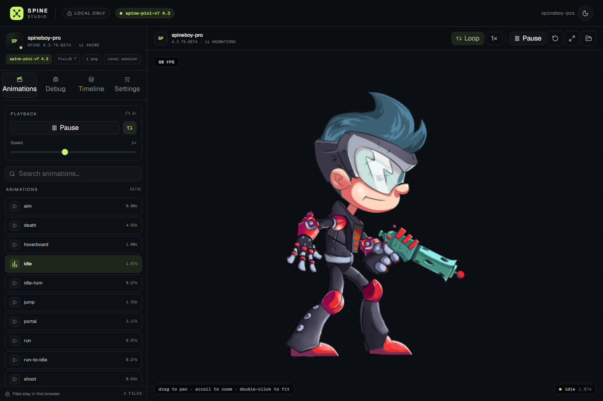
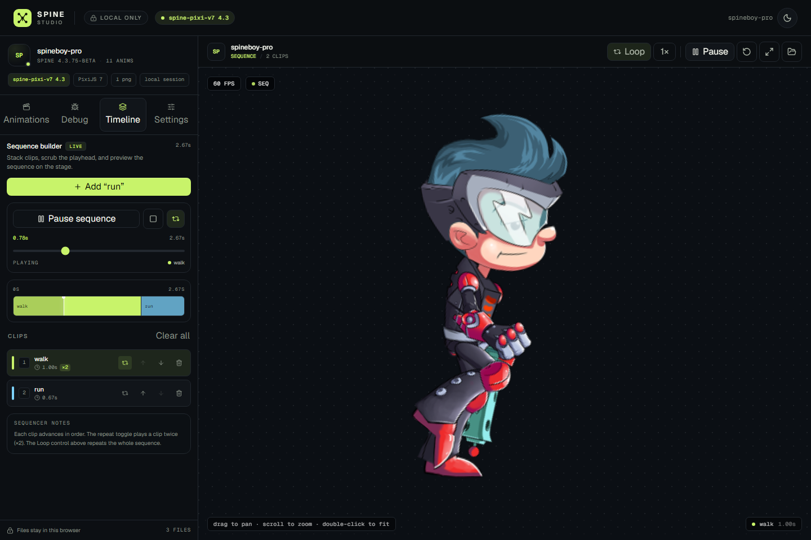

# Spine Studio

A local-first viewer and debugger for Spine skeletal animations, built with Next.js (App Router), PixiJS 7, and version-aware Spine runtimes.



> The preview above is a local test capture using the Spineboy example assets. Example assets are not included in the app.

## Features

- **Drag & drop loading** — `.json`, `.skel`, `.atlas`, and every `.png` texture page.
- **Version detection** — reads the skeleton version from JSON or binary headers and picks the matching runtime.
- **Runtime switching**
  - Spine **3.8.x** → `@pixi-spine/runtime-3.8` (`pixi-spine` 4.0.6)
  - Spine **4.2.x** → official `@esotericsoftware/spine-pixi-v7` 4.2.120
  - Spine **4.3.x+** → official `@esotericsoftware/spine-pixi-v7` 4.3.13
- **Single PixiJS instance** — PixiJS 7.4.3 renders every runtime through the same canvas. Runtime modules are imported on demand, so the initial bundle stays small.
- **Animations tab** — search, play/pause, loop, speed, and duration for every animation in the skeleton.
- **Debug tab** — bones, mesh triangles/hulls, paths, bounding boxes, and region overlays via each runtime's debug renderer.
- **Timeline tab** — real sequence playback with clip add/remove/reorder, per-clip repeat (×2), sequence loop, play/pause/stop, scrubbing, progress playhead, and active-clip highlighting.
- **Playback-aware toolbar** — the top transport follows either the selected animation or the active sequence.
- **Settings tab** — canvas background presets/custom color, FPS overlay, loaded assets, runtime details.
- **Stage controls** — fit to view, drag to pan, wheel to zoom, double-click to fit.
- **Light/dark themes** — `next-themes` with a custom design system.
- **100% local** — uploaded files never leave the browser.

## Timeline playback



Add animations to the sequence, optionally repeat a clip twice, then play the whole sequence on the same stage. The timeline exposes:

- play / pause / stop & rewind;
- sequence loop (separate from the per-clip repeat toggle);
- scrub via the range input or by clicking a clip name;
- active clip and playhead highlighting;
- live duration and current time.

Seeking positions the current clip at the correct local animation time, so pausing and scrubbing are frame-accurate enough for review.

## Tech stack

- Next.js 16.4 (App Router, TypeScript, Turbopack)
- React 19.3
- Tailwind CSS 4.3
- PixiJS 7.4.3
- Zustand 5
- react-dropzone 20
- next-themes
- lucide-react

## Getting started

```bash
pnpm install
pnpm dev
```

Open [http://localhost:3000](http://localhost:3000).

Production:

```bash
pnpm build
pnpm start
```

Checks:

```bash
pnpm lint
pnpm typecheck
```

## Supported uploads

Drop the complete Spine export together:

| File | Required | Notes |
| --- | --- | --- |
| `.json` or `.skel` | One | Skeleton data |
| `.atlas` | One | Atlas description |
| `.png` | One or more | Every texture page referenced by the atlas |

Multiple skeleton or atlas files in one drop are rejected to avoid ambiguous loads. Spine 4.0/4.1 exports are not supported by this build; use a 3.8, 4.2, or 4.3+ export.

## Why PixiJS 7 instead of 8?

There is no maintained Spine 3.8 integration for PixiJS 8. The available `pixi-spine` 4.x runtime targets PixiJS 7, while the official `spine-pixi-v8` only supports Spine 4.2+. To keep a single canvas, one renderer, and seamless switching between 3.8 and 4.2/4.3 within one app session, this project uses PixiJS 7 with:

- `pixi-spine` for 3.8
- the official `spine-pixi-v7` runtime for 4.2 and 4.3+

The runtime is selected after the skeleton version is detected and loaded with a dynamic `import()`, so only the needed runtime chunk is fetched.

## Architecture

```text
src/
  app/
    page.tsx                 — renders the client workspace
    layout.tsx               — fonts, metadata, theme provider
    globals.css              — design tokens and Tailwind 4 theme
  components/
    brand/                   — logo
    layout/header.tsx        — logo, local badge, runtime badge, theme toggle
    sidebar/                 — tab shell + Animations/Debug/Timeline/Settings
    workspace/
      spine-workspace.tsx    — page state machine (idle/loading/ready/error)
      dropzone.tsx           — react-dropzone + validation + empty state
      spine-stage.tsx        — Pixi app, pan/zoom/fit, FPS, playback wiring
      viewer-toolbar.tsx     — transport, loop, speed, fit, replace files
      loading-overlay.tsx
      load-error-state.tsx
    ui/                      — button, switch
  lib/
    timeline.ts              — clip layout, durations, active-clip math
    spine/
      detect-version.ts      — JSON/binary version detection and runtime mapping
      load-spine.ts          — texture/atlas loading + runtime adapters
      types.ts               — shared Spine handle/version/debug types
  store/
    viewer-store.ts          — Zustand session, playback, debug, timeline state
```

### Runtime adapter contract

Both runtime adapters expose the same small interface: `play(name, loop, startTime?)`, `setPaused`, `setSpeed`, `setLoop`, `restart`, `setDebug`, `update`, `getBounds`, and `destroy`. This keeps the Pixi render loop and all UI code runtime-agnostic, while `startTime` makes timeline scrubbing possible.

### Timeline state

`lib/timeline.ts` converts clips into segments with absolute start/end times and computes the active segment for a given playhead time. `SpineStage` advances the playhead on the Pixi ticker, opens the active animation at its local time, updates the store at a throttled rate, and hands control back to the single-animation player when a clip is selected from the Animations tab.

## Notes and limitations

- This is a viewer/debugger, not a full animation editor. Sequence playback uses hard cuts between clips; crossfades/mix durations are not implemented yet.
- Only one character can be loaded at a time.
- `Spine 4.3.75-beta` example data was used during local verification, along with Spine 3.8 and 4.2 examples.
- No assets are bundled with the app. Bring your own Spine exports.
- Spine Runtimes are used under the [Spine Runtimes License](https://esotericsoftware.com/spine-runtimes-license). Make sure your use of Spine assets and runtimes complies with the license; each user generally needs a Spine Editor license.
